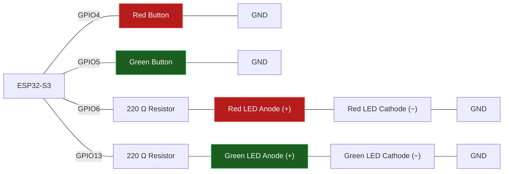

# Task — Reading Inputs and Selection (Week 3)

Build a two-button LED control system that reads digital inputs and uses `if / else if / else` to decide what to do.

**Scenario:** 

A small control panel has a red button and a green button. Pressing the red button should light the red LED only; pressing the green button should light the green LED only; if neither is pressed, both LEDs stay off.

**Components required:**
- ESP32-S3 development board
- 2 × push buttons
- 2 × LEDs (red, green)
- 2 × 220 Ω resistors
- Jumper wires

>
> **Wiring:**
>



**Requirements:**
- Configure both buttons as `INPUT_PULLUP` and both LEDs as `OUTPUT`.
- Read both buttons every loop with `digitalRead()`.
- Use `if / else if / else` so exactly one outcome happens per loop: red pressed → red LED on, green off; green pressed → green LED on, red off; neither pressed → both off.
- Print which branch ran to the Serial Monitor.
- Add a short `delay()` after each reading to debounce the buttons.

>
> Wokwi Link : https://wokwi.com/projects/472054525585822721
>

**Task** - Reading Inputs and Selection
```cpp
/*
=== 3.1 Two-Button LED Control System ===
        Author: Roberto Palozzo
=========================================
*/

const int redButtonPin   = 4;
const int greenButtonPin = 5;
const int redLedPin      = 6;
const int greenLedPin    = 13;

String lastBranch = "";                // last branch printed

void setup() {
  Serial.begin(115200);
  pinMode(redButtonPin, INPUT_PULLUP);
  pinMode(greenButtonPin, INPUT_PULLUP);
  pinMode(redLedPin, OUTPUT);
  pinMode(greenLedPin, OUTPUT);
}

void loop() {
  int redState   = digitalRead(redButtonPin);
  int greenState = digitalRead(greenButtonPin);
  delay(50);                           // simple debounce

  String branch;

  if (redState == LOW) {               // red pressed (INPUT_PULLUP: pressed = LOW)
    digitalWrite(redLedPin, HIGH);
    digitalWrite(greenLedPin, LOW);
    branch = "Red button -> red LED on";
  } else if (greenState == LOW) {      // green pressed
    digitalWrite(redLedPin, LOW);
    digitalWrite(greenLedPin, HIGH);
    branch = "Green button -> green LED on";
  } else {                             // nothing pressed
    digitalWrite(redLedPin, LOW);
    digitalWrite(greenLedPin, LOW);
    branch = "No button -> both LEDs off";
  }

  // print only when the branch changes, so the monitor stays readable
  if (branch != lastBranch) {
    Serial.println(branch);
    lastBranch = branch;
  }
}
```
Wokwi link: https://wokwi.com/projects/477652430153669633

### Questions

- Why does `INPUT_PULLUP` make "pressed" read `LOW` instead of `HIGH`?
  ```
  This is because when the button pins are set to INPUT_PULLUP, the pin is supplied with
  3.3V via an internal resistor; consequently, when the button is not pressed, the pin
  detects a voltage corresponding to HIGH (or 1). Since the button is connected between
  the pin and GND, pressing it pulls the voltage down to ground, resulting in a LOW (or 0)
  reading. That is why the "pressed" state corresponds to LOW.
  ```

- What would go wrong if you checked the two buttons using two separate `if` statements instead of one `if / else if`?
  ```
  With two separate `if` blocks, both are executed sequentially in the order they are
  written—first one, then the other.
  In contrast, using `if` / `else if` / `else` allows you to handle different situations
  based on different actions; in short, the result is: "turn on the red LED if the red
  button is pressed; otherwise, turn on the green LED if the green button is pressed; and
  do nothing if neither button is pressed."
  ```

- Why does adding `delay(50)` after reading a button count as debouncing?
  ```
  When a button is pressed, its metal contacts bounce for a few milliseconds due to the
  spring mechanism, creating a series of rapid opening and closing events that the
  microcontroller can detect. Waiting 50 ms after the button is pressed allows this
  transition phase to be bypassed; this ensures the program reads the state only after the
  contacts have stabilized, registering a single, clean press rather than a burst of
  pulses.
  ```

- In `if / else if / else`, if both buttons happened to read `LOW` at the same instant, which branch would run, and why?
  ```
  The red LED branch, because it is the first condition evaluated from top to bottom.
  Since it is true, it is executed immediately, causing all subsequent branches (including
  the green *else if*) to be skipped entirely. For this reason, the red LED takes
  precedence.
  ```

### Spot-the-Bug Worksheet


**Round 1:**

```cpp
void loop() {
  int buttonState = digitalRead(BUTTON_PIN);

  if (buttonState = LOW) {
    digitalWrite(LED_PIN, HIGH);
  }
}
```

<details><summary>Answer</summary><code>=</code> is assignment, not comparison — this sets <code>buttonState</code> to <code>LOW</code> (always true) instead of checking it. It should be <code>if (buttonState == LOW)</code>.</details>

**Round 2:**

```cpp
void setup() {
  pinMode(BUTTON_PIN, INPUT);
  pinMode(LED_PIN, OUTPUT);
}

void loop() {
  if (digitalRead(BUTTON_PIN) == LOW) {
    digitalWrite(LED_PIN, HIGH);
  }
}
```
<details><summary>Answer</summary><code>BUTTON_PIN</code> is set to plain <code>INPUT</code> instead of <code>INPUT_PULLUP</code> — with nothing holding the pin HIGH when released, it floats and gives unreliable readings instead of reliably reading LOW only when pressed.</details>

**Round 3:**

```cpp
void loop() {
  int redButton = digitalRead(redButtonPin);
  int greenButton = digitalRead(greenButtonPin);

  if (redButton == LOW) {
    digitalWrite(redLED, HIGH);
  }
  if (greenButton == LOW) {
    digitalWrite(greenLED, HIGH);
  }
}
```
<details><summary>Answer</summary>Neither LED is ever turned back <code>LOW</code> when its button is released — there's no <code>else</code> branch, so once a button is pressed its LED stays on forever.</details>

**Round 4:**
```cpp
void loop() {
  int motionDetected = digitalRead(PIR_PIN);
  bool afterHours = true;

  if (motionDetected == HIGH || afterHours) {
    digitalWrite(BUZZER_PIN, HIGH);
  } else {
    digitalWrite(BUZZER_PIN, LOW);
  }
}
```
<details><summary>Answer</summary>Using <code>||</code> (OR) means the buzzer sounds if <em>either</em> condition is true — since <code>afterHours</code> is always <code>true</code> here, the buzzer fires constantly regardless of motion. The scenario calls for both conditions together, so it should be <code>&&</code> (AND).</details>

**Round 5:**
```cpp
void loop() {
  int temperature = analogRead(TEMP_PIN);

  if (temperature > 0) {
    Serial.println("Cold");
  } else if (temperature > 20) {
    Serial.println("Warm");
  } else if (temperature > 35) {
    Serial.println("Hot");
  }
}
```
<details><summary>Answer</summary>The conditions are ordered broadest-first — <code>temperature > 0</code> matches almost every reading, so the <code>"Warm"</code> and <code>"Hot"</code> branches can never be reached. The most specific/narrow condition should be checked first.</details>

**Round 6:**
```cpp
void loop() {
  int potValue = analogRead(potPin);
  int brightness = map(potValue, 0, 4095, 0, 255);
  digitalWrite(ledPin, brightness);
}
```
<details><summary>Answer</summary><code>digitalWrite()</code> only accepts <code>HIGH</code> or <code>LOW</code> — a variable brightness value needs <code>analogWrite(ledPin, brightness)</code> to produce PWM output.</details>


