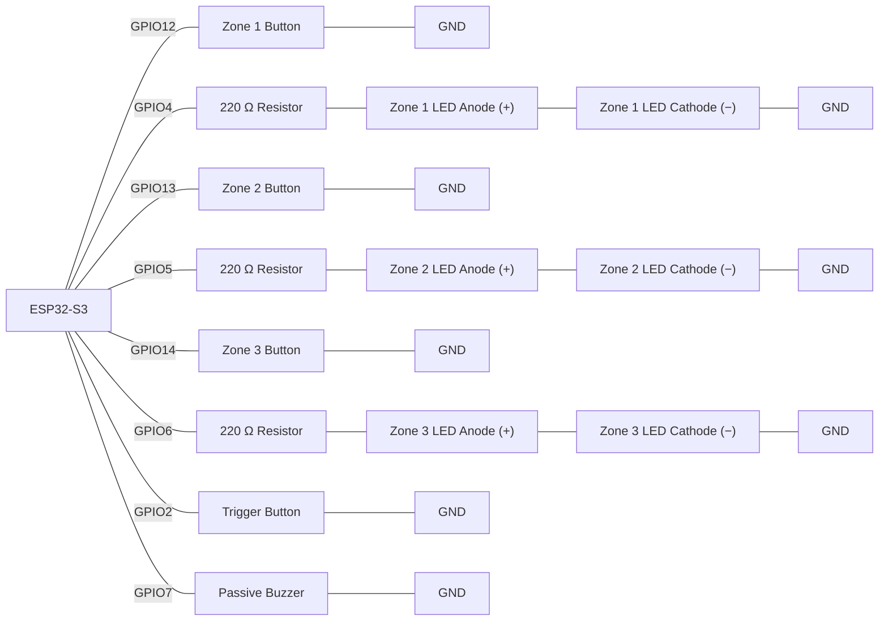

# Task - Lists, Arrays & Loops (Week 5)

Build a non-blocking, 3-zone security panel: each zone has its own arm/disarm button and status LED, and triggering an armed zone plays that zone's own buzzer alert pattern, looked up from a 2-D array — all without a single `delay()`.

**Scenario:**

A workshop bench station has 3 independent security zones. Pressing a zone's button toggles whether that zone is armed, lighting its matching LED. A separate "Trigger" button simulates an intrusion: when pressed, the program checks the zones in order and, for the first one it finds armed, plays that zone's own beep pattern on a buzzer — each zone has a different pattern, stored as one row of a 2-D array of beep durations. Every button on the panel must stay independently debounced and responsive, even while an alert is mid-playback.

**Components required:**
- ESP32-S3 development board
- 3 × push button (`INPUT_PULLUP`) — zone arm/disarm
- 3 × LED — zone status
- 3 × 220 Ω resistor
- 1 × push button (`INPUT_PULLUP`) — trigger
- 1 × passive buzzer
- Jumper wires, breadboard

>
> **Wiring:**
>



**Requirements:**
- Declare parallel arrays `const int zonePins[3]`, `const int zoneLedPins[3]`, and `bool zoneArmed[3]` — index `i` refers to the same zone across all three.
- Give every zone button (and the separate Trigger button) its own settle-based debounce state, using per-index arrays (e.g. `lastZoneReading[3]`/`debounceStart[3]`/`buttonState[3]` for the zone buttons, and separate scalars for the single Trigger button) — the same technique as this week's Resource examples, not a burst-sample.
- A debounced press of a zone button toggles `zoneArmed[i]` and drives `zoneLedPins[i]` to match.
- Declare `const int NUM_ZONES = 3;` and `const int PATTERN_LENGTH = 4;`, then `const int alertPatterns[NUM_ZONES][PATTERN_LENGTH]` — one row of beep/gap durations (in ms) per zone, each zone's pattern different.
- On a debounced Trigger press, use a `for` loop to find the **first** armed zone (`zoneArmed[i] == true`) and start playing `alertPatterns[i]` non-blocking (if no zone is armed, do nothing).
- Write `updatePlayback()`, called every pass of `loop()`, which uses `millis()` to step through the active pattern one entry at a time — toggling the buzzer tone on/off — and stops cleanly once the pattern's `PATTERN_LENGTH` entries are exhausted.
- Do not use `delay()` anywhere in `loop()` — every button must be readable on every single pass, including while a pattern is playing.

**Extension (optional):**
- Add `int triggerCount[NUM_ZONES]`, incremented every time that zone's pattern is triggered, and print the full array whenever it changes.
- Add a fourth "silence" button that immediately stops whatever pattern is currently playing (without disarming any zone).

**Task - Lists, Arrays & Loops**  
```cpp
/*
=== Task.md - Lists, Arrays & Loops (Week 5) ===
            Author: Roberto Palozzo
================================================
*/

const int zonePins[3]    = {12, 13, 14};
const int zoneLedPins[3] = {4, 5, 6};
bool zoneArmed[3]        = {false, false, false};

const int triggerPin = 2;
const int silencePin = 15;   // extension: wire to GND (INPUT_PULLUP)
const int buzzerPin = 7;

const int NUM_ZONES = 3;
const int PATTERN_LENGTH = 4;
// row = zone, column = step duration (ms); even index = beep, odd = silence
const int alertPatterns[NUM_ZONES][PATTERN_LENGTH] = {
  {1000, 1000, 1000, 1000},  // Zone 1: slow beeps
  {500, 500, 500, 500},      // Zone 2: medium beeps
  {200, 200, 200, 200}       // Zone 3: fast beeps
};

// Per-zone debounce state: each zone needs its own copy of these 3,
// otherwise debouncing one button's bounce would interfere with another's
int lastZoneReading[3]      = {HIGH, HIGH, HIGH};   // raw reading, last pass
int zoneButtonState[3]      = {HIGH, HIGH, HIGH};   // debounced, trusted state
unsigned long zoneDebounceStart[3] = {0, 0, 0};     // when the raw reading last changed

int lastTriggerReading = HIGH;
int triggerButtonState = HIGH;
unsigned long triggerDebounceStart = 0;

int lastSilenceReading = HIGH;
int silenceButtonState = HIGH;
unsigned long silenceDebounceStart = 0;

const unsigned long DEBOUNCE_DELAY = 50;

bool patternPlaying = false;   // is any alert pattern currently running
int activeZone = 0;            // which zone's pattern is playing
int currentStep = 0;           // which step (row entry) of that pattern we're on
unsigned long stepStartTime = 0;
bool buzzerIsOn = false;

int triggerCount[NUM_ZONES] = {0, 0, 0};

void setup() {
  Serial.begin(115200);

  for (int i = 0; i < 3; i++) {
    pinMode(zonePins[i], INPUT_PULLUP);
    pinMode(zoneLedPins[i], OUTPUT);
    digitalWrite(zoneLedPins[i], LOW);
  }

  pinMode(triggerPin, INPUT_PULLUP);
  pinMode(silencePin, INPUT_PULLUP);
  pinMode(buzzerPin, OUTPUT);
  noTone(buzzerPin);
}

void loop() {
  checkZoneButtons();
  checkTriggerButton();
  checkSilenceButton();
  updatePlayback();
}

void checkZoneButtons() {
  for (int i = 0; i < 3; i++) {
    int reading = digitalRead(zonePins[i]);

    // raw reading just changed: restart this zone's settle timer
    if (reading != lastZoneReading[i]) {
      zoneDebounceStart[i] = millis();
    }

    // reading has been stable for DEBOUNCE_DELAY: trust it
    if (millis() - zoneDebounceStart[i] >= DEBOUNCE_DELAY) {
      if (reading != zoneButtonState[i]) {
        zoneButtonState[i] = reading;

        // toggle only on the press edge, not on release or while held
        if (zoneButtonState[i] == LOW) {
          toggleZone(i);
        }
      }
    }

    lastZoneReading[i] = reading;
  }
}

void toggleZone(int i) {
  zoneArmed[i] = !zoneArmed[i];
  digitalWrite(zoneLedPins[i], zoneArmed[i] ? HIGH : LOW);
}

void checkTriggerButton() {
  int reading = digitalRead(triggerPin);

  if (reading != lastTriggerReading) {
    triggerDebounceStart = millis();
  }

  if (millis() - triggerDebounceStart >= DEBOUNCE_DELAY) {
    if (reading != triggerButtonState) {
      triggerButtonState = reading;

      // fires exactly once per press, not repeatedly while held
      if (triggerButtonState == LOW) {
        fireTrigger();
      }
    }
  }

  lastTriggerReading = reading;
}

void fireTrigger() {
  // stop at the FIRST armed zone found - lower zone number wins if several are armed
  for (int i = 0; i < NUM_ZONES; i++) {
    if (zoneArmed[i]) {
      startPattern(i);
      return;
    }
  }
  // loop finished with no match: no zone armed, do nothing
}

void startPattern(int zone) {
  activeZone = zone;
  currentStep = 0;
  patternPlaying = true;
  stepStartTime = millis();

  tone(buzzerPin, 2000);   // step 0 is always a beep (even index = sound)
  buzzerIsOn = true;

  triggerCount[zone]++;
  printTriggerCounts();
}

void checkSilenceButton() {
  int reading = digitalRead(silencePin);

  if (reading != lastSilenceReading) {
    silenceDebounceStart = millis();
  }

  if (millis() - silenceDebounceStart >= DEBOUNCE_DELAY) {
    if (reading != silenceButtonState) {
      silenceButtonState = reading;

      if (silenceButtonState == LOW) {
        stopPattern();
      }
    }
  }

  lastSilenceReading = reading;
}

void stopPattern() {
  patternPlaying = false;   // does NOT touch zoneArmed[] - only silences the buzzer
  noTone(buzzerPin);
  buzzerIsOn = false;
}

void updatePlayback() {
  if (!patternPlaying) return;

  // duration of the step we're currently on, not the next one
  unsigned long stepDuration = alertPatterns[activeZone][currentStep];

  if (millis() - stepStartTime >= stepDuration) {
    currentStep++;
    stepStartTime = millis();

    // pattern exhausted: turn patternPlaying off now, so no later call
    // ever reads alertPatterns[activeZone][currentStep] with an out-of-range index
    if (currentStep >= PATTERN_LENGTH) {
      patternPlaying = false;
      noTone(buzzerPin);
      buzzerIsOn = false;
      return;
    }

    if (currentStep % 2 == 0) {
      tone(buzzerPin, 2000);
      buzzerIsOn = true;
    } else {
      noTone(buzzerPin);
      buzzerIsOn = false;
    }
  }
}

void printTriggerCounts() {
  Serial.print("triggerCount: [");
  for (int i = 0; i < NUM_ZONES; i++) {
    Serial.print(triggerCount[i]);
    if (i < NUM_ZONES - 1) Serial.print(", ");
  }
  Serial.println("]");
}
```
Wokwi Link : https://wokwi.com/projects/473374044178894849

### Questions

- Why must `zonePins[]`, `zoneLedPins[]`, and `zoneArmed[]` always be read and written at the same index `i`, rather than any one of them ever drifting out of sync with the others?
  ```
  Parallel arrays are linked only by their index: zonePins[1], zoneLedPins[1] and
  zoneArmed[1] all describe zone 2. If one of them used a different index, a button
  would toggle the wrong zone or light the wrong LED, and the compiler would not warn
  me. Using the same i everywhere keeps the three arrays describing the same zone.
  ```

- Why does each zone button need its own entry in the debounce arrays, instead of one shared set of debounce variables covering all three?
  ```
  Each button bounces at its own time and is pressed independently. With one shared
  set of variables, a change on one button would reset the timer of the others, so a
  press on zone 2 could be lost or counted for zone 1. Separate entries
  (lastZoneReading[i], zoneDebounceStart[i], zoneButtonState[i]) let every button
  settle on its own, even when two are pressed close together.
  ```

- In `alertPatterns[NUM_ZONES][PATTERN_LENGTH]`, why does the order of the two indices matter, even though `alertPatterns[zone][step]` and `alertPatterns[step][zone]` would allocate the same total amount of memory?
  ```
  The first index selects the row and the second the column. The table is declared
  with one row per zone and one column per step, so alertPatterns[zone][step] is the
  only correct way to read it. Swapping them would read the wrong values and, because
  NUM_ZONES is 3 but PATTERN_LENGTH is 4, step 3 used as the first index would read
  outside the array.
  ```

- Why does the search for "the first armed zone" need a `for` loop that can stop as soon as it finds one, rather than checking all 3 zones unconditionally every time?
  ```
  The task asks for the first armed zone only, so once it is found the search is
  finished. In fireTrigger() the return stops the loop there and starts that zone's
  pattern. If the loop kept going, a later armed zone could start its pattern instead
  and the wrong alert would play. Stopping early is also faster, and the loop still
  works if the number of zones changes.
  ```

- What would go wrong if `updatePlayback()` used `delay()` between each pattern step instead of checking `millis()` every pass?
  ```
  delay() would freeze the whole program for every beep and gap, so for the full
  length of the pattern no button would be read. Pressing a zone button, the Trigger
  or the Silence button during the alert would be missed, and the debounce timers
  would stop working. Checking millis() on every pass lets the pattern advance while
  loop() keeps reading all the buttons.
  ```

- Why does `updatePlayback()` need to check the pattern index against `PATTERN_LENGTH` before reading `alertPatterns[zone][step]`?
  ```
  Each row has only PATTERN_LENGTH entries (indices 0 to 3). After the last step the
  index becomes 4, and alertPatterns[activeZone][4] would read outside the row, into
  the next zone's pattern or random memory. Checking currentStep >= PATTERN_LENGTH
  first lets updatePlayback() stop the buzzer and end playback cleanly instead of
  playing garbage values.
  ```

### Spot-the-Bug Worksheet


**Round 1:**
```cpp
const int NUM_ZONES = 3;
bool zoneArmed[NUM_ZONES];

void printZones() {
  for (int i = 0; i <= NUM_ZONES; i++) {
    Serial.println(zoneArmed[i]);
  }
}
```
<details><summary>Answer</summary>The condition should be <code>i &lt; NUM_ZONES</code>, not <code>i &lt;= NUM_ZONES</code>. As written, the loop reads <code>zoneArmed[3]</code> on its last pass — one index past the end of a 3-element array, which is out of bounds.</details>

**Round 2:**
```cpp
const int zonePins[3] = {12, 13, 14};
const int zoneLedPins[3] = {4, 5, 6};
bool zoneArmed[3] = {false, false, false};

void toggleZone(int i) {
  zoneArmed[0] = !zoneArmed[0];
  digitalWrite(zoneLedPins[0], zoneArmed[0]);
}
```
<details><summary>Answer</summary><code>toggleZone()</code> receives the zone index <code>i</code> as a parameter but never uses it — every call hard-codes index <code>0</code> instead. Toggling zone 2 or 3 silently toggles zone 1 again. It should use <code>zoneArmed[i]</code> and <code>zoneLedPins[i]</code> throughout.</details>

**Round 3:**
```cpp
int lastZoneReading[3] = {HIGH, HIGH, HIGH};
unsigned long debounceStart[3] = {0, 0, 0};

void checkZoneButtons() {
  for (int i = 0; i < 3; i++) {
    int reading = digitalRead(zonePins[i]);
    debounceStart[i] = millis();

    if (millis() - debounceStart[i] >= 50 && reading != lastZoneReading[i]) {
      toggleZone(i);
    }
    lastZoneReading[i] = reading;
  }
}
```
<details><summary>Answer</summary><code>debounceStart[i]</code> is reset to <code>millis()</code> on <em>every</em> pass, not only when the raw reading changes, so <code>millis() - debounceStart[i]</code> never has a chance to reach 50 ms. The reset should only happen inside an <code>if (reading != lastZoneReading[i])</code> check.</details>

**Round 4:**
```cpp
const int NUM_ZONES = 3;
const int PATTERN_LENGTH = 4;
const int alertPatterns[NUM_ZONES][PATTERN_LENGTH] = {
  {200, 200, 200, 200},
  {400, 400, 400, 400},
  {100, 100, 100, 100}
};

int getBeep(int step, int zone) {
  return alertPatterns[step][zone];
}
```
<details><summary>Answer</summary><code>alertPatterns</code> was declared <code>[NUM_ZONES][PATTERN_LENGTH]</code> — zone first, step second — but <code>getBeep()</code> reads <code>alertPatterns[step][zone]</code>, the axes reversed. Since <code>NUM_ZONES</code> is only 3, any <code>step</code> value of 3 used as the first index reads out of bounds. It needs to match the declared order: <code>alertPatterns[zone][step]</code>.</details>

**Round 5:**
```cpp
bool patternPlaying = false;
int currentStep = 0;
int activeZone = 0;

void updatePlayback() {
  if (!patternPlaying) return;

  Serial.println(alertPatterns[activeZone][currentStep]);
  currentStep++;
}
```
<details><summary>Answer</summary>There's no timing check at all — <code>updatePlayback()</code> advances <code>currentStep</code> and prints a new pattern entry on <em>every single pass</em> of <code>loop()</code> (potentially thousands of times per second) instead of once per beep duration. It needs a <code>millis()</code>-based check against the current step's duration before advancing, and it never checks <code>currentStep</code> against <code>PATTERN_LENGTH</code> either, so it will keep reading past the end of the pattern array once the real pattern is exhausted.</details>

**Round 6:**
```cpp
int triggerCount[3] = {0, 0, 0};

void onTrigger(int zone) {
  triggerCount[zone]++;
  Serial.println(triggerCount);
}
```
<details><summary>Answer</summary><code>Serial.println(triggerCount)</code> prints the array's memory address (since <code>triggerCount</code> decays to a pointer), not its contents. Printing the actual values requires a <code>for</code> loop over the array, printing <code>triggerCount[i]</code> for each index.</details>

**Round 7:**
```cpp
int lastTriggerReading = HIGH;
unsigned long triggerDebounceStart = 0;

void loop() {
  int reading = digitalRead(triggerPin);
  if (reading != lastTriggerReading) {
    triggerDebounceStart = millis();
  }

  if (millis() - triggerDebounceStart >= 50 && reading == LOW) {
    fireTrigger();
  }

  lastTriggerReading = reading;
}
```
<details><summary>Answer</summary>There's no check against a stored, debounced <code>triggerState</code> before calling <code>fireTrigger()</code> — once the button has been held LOW for 50 ms, this condition stays true on <em>every subsequent pass</em> for as long as the button remains held, calling <code>fireTrigger()</code> repeatedly instead of once per press. It needs to compare against a stored debounced state and only fire on the transition, the same way the zone buttons do.</details>
